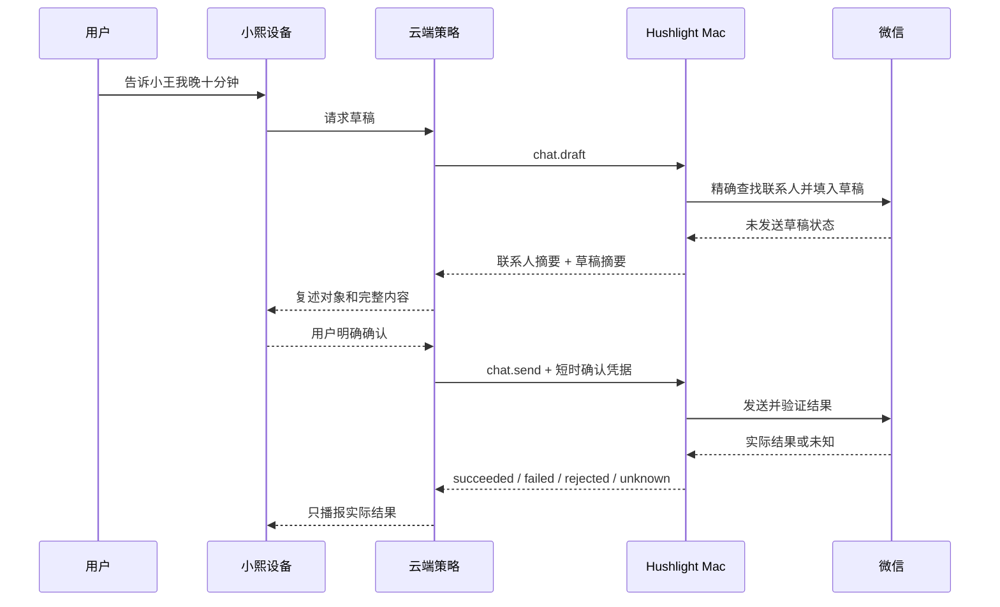

# Agent 工作台产品需求文档

## 2026-10-24 QQ聊天首步

QQ聊天与QQ音乐独立。首步新增“QQ聊天”页：用户先在QQ打开指定会话，再主动读取当前可见文字；只在本机内存预览，不调用AI、不持久化正文，离页/清除/暂停后丢弃。缺少辅助功能或不能唯一核实界面结构时显示错误，不自动申请权限、切换会话或发送。昵称只用于显示，不当作稳定账号/联系人身份。

Codex已通过CUA完成一次用户指定单聊发送与回读，但不等于产品适配已完成。后续发送/自动回复必须接入共享执行服务、目标范围、停止和持久去重；本步不新增聊天MCP工具或外部Agent权限。

## 2026-10-24 用户调整：自动目标识别与群聊会话

窗口内容由本机Vision自动识别并定位用户目标，不再要求手动框选作为必经步骤。自动选错时刷新目标窗口并重新识别、复核，有界纠错后仍不确定则明确停止，不能盲点或把尝试记为成功。手动框选保留为可选诊断入口。

明确的“播放某歌曲”指令就是该次播放授权，唯一核对歌曲/歌手后直接播放，不额外确认；回读实际曲目/播放状态，未知不盲重按。

“在某个群聊天”建立绑定该具体群的持续会话授权，普通聊天在会话内无需逐条确认。只允许指定群，不扩展到私聊/其他群、附件或支付等动作；用户说停、全局暂停、撤销或目标身份失去核实立即阻止后续发送。已被系统接纳的消息如实记录，不声称能撤回。会话授权不跨App重启自动恢复；重新登录或账号变化须重新核对目标。邮件逐封确认保持现有规则。

自动识别默认在本机运行；聊天内容交AI时仅采集该已授权群的必要上下文，按所选分析Agent配置处理，不将整桌面或其他会话送入模型。当前没有指定实际群，因此本轮不自行发送聊天。

## 2026-10-24 天气联动验收入口

已启用天气规则可由本人在App“手动运行一次”，按原范围尝试通知和摘要，显示实际结果。每条规则当天持久接纳一次手动来源；06:00常规排程独立保留，手动操作不消耗早间次数。采集前失败可再次尝试；已接纳分析重试复用原来源，未知写入不重放。手动建议15分钟或本地午夜前有效，过期确认清理。

## 2026-10-24 语音到动作提案

手动语音预览或直接输入文字后，可主动交给 Codex 分析；仅上方文本按 Codex 模型配置处理。首次支持音量读取、相对计时器、指定城市当前天气。先展示从结构化字段计算的完整动作，点击确认才执行；未经确认、修改输入、暂停、离页或提案过期均不执行新动作。不提供语音自动发送、任意命令或内置聊天。计时器写入未知需核对，不自动重建。

## 2026-10-24 可选窗口识别

依据用户明确确认，新增只读窗口识别页。仅显式选定 QQ/微信窗口，屏幕录制权限由用户单独授权并复用，拒绝时不循环弹窗。先在本机预览选定窗口，再由用户拖动框选本次交给 Vision 的区域；没有默认全窗口 OCR，也不按固定比例猜测歌曲/输入框边界。预览会包含该窗口可见内容，页面明确说明并提醒避开无关聊天/账户内容。不保存截图/识别内容，不发给外部 AI；离页或暂停取消后续识别并清除状态。结果属于该张预览的时间点，不表示当前窗口未变化，也不等于联系人身份；首步不据此点击、播放或发送。

## 2026-10-24 Mac 语音输入小步

新增独立语音页：用户明确授权麦克风/语音识别后，手动开始和停止，预览、修改、复制文本。只使用设备端识别，支持条件不满足即失败；不回退云端，不保存原始音频或转写，不自动提交给 Agent。每次最多 60 秒，暂停、离开页面或窗口失去焦点结束录音；已有系统授权静默复用。首版语言为普通话、美国英语、法语，实际设备端可用性按本机返回值核对。语音到 Agent 执行与 iPhone 入口仍属后续，不能因文本识别实现而宣布完成。

## 2026-10-23 当前增量：权限复用与能力联动

已实现联动中心、固定城市早间天气、增量邮件助理、明确事项专用日历/提醒和每日 Notes 摘要。每条规则明确授权来源、分析 Agent 和具体输出范围；系统权限静默复用、范围失效不重建，发送继续逐封确认。旧“每次启动重新连接 Notes”要求废止。模型置信度不单独构成自动写入依据。完整规则、限制与实机边界见 [联动工作台](13_automation_workbench.md)。

## 2026-10-23 Apple Mail 草稿与逐封确认发送

用户明确要求打通读取、写草稿和发送，发送必须本人确认。邮件页分为读取、写草稿和发送确认。用户或获授权 Agent 可创建并回读原生 Mail 纯文本草稿；发件地址必须唯一属于所选账户，To/Cc/Bcc 总数最多 20，主题最多 512 字符、正文最多 24000 字符。附件、修改现有草稿和自动回复后置。

Agent 的 mail.read、mail.write（创建草稿）、mail.send.request 分别授权并绑定邮箱范围。发送请求只进入待确认状态，不能代替用户确认。App 必须完整展示发件人、To/Cc/Bcc、主题、正文与无附件状态；用户点击“确认发送”后才准入。关闭或暂不发送不触发发送。发送前再次比对全部内容，内容变化要求重新核对。确认预览有效期十分钟，Agent 重复请求不能延长；用户主动重新核对可以开始新的预览。

Mail 返回接受只标记 submitted，不宣称送达。发送前先持久化 dispatching；中断或未知结果保持 unknown，不自动重放。外部工具可查本连接草稿的发送状态，但没有直接发送或批准工具。最终授权许可为准入点：暂停/撤销阻止后续准入，已经准入的发送可能完成。Mail 不提供草稿快照与发送的原子事务，用户确认期间应停止在 Mail 中编辑该草稿；真实操作单独验收。

## 2026-10-23 Apple Mail 只读首版

用户在 App 选择账户与邮箱后，可按标题/发件人关键词搜索、只看未读，并点选一封读取纯文本。搜索不取正文，读取不执行显式标记、移动或发送；不提供附件、HTML 渲染、草稿和发送。首版对单邮箱 1000 封、50 条匹配和 24000 字符正文设置上限，超过时明确失败，不以截断结果冒充完整结果。

每个 Agent 单独授予邮箱读取，默认关闭；保存时绑定当前账户和邮箱路径。切换邮箱后旧授权停止生效，App 展示新路径供用户核对并重新保存授权。已选范围跨重启保留，操作前后重新核对；执行记录不含标题、发件人或正文。邮件内容始终是数据，不能变成 Agent 指令。

> 文档版本：V0.2
> 更新日期：2026-10-22
> 状态：开发基线

## 1. 产品目标

让用户通过原生分页界面管理 Mac 能力，并允许 Codex、小熙及其他本地 Agent 在各自授权范围内使用同一执行核心。所有入口展示真实返回的成功、失败、拒绝或未知结果。

新增软件开发目标（D-MAC-014，2026-10-22）：无需硬件即可通过本地命令完成执行链验证，核心可复用于其他项目。CLI 作为独立开发/工具产品，不替代面向非技术用户的菜单栏与安装流程。

## 2. 用户与系统角色

| 角色 | 需要 | 责任边界 |
| --- | --- | --- |
| 成年用户 | 安装一次后通过设备语音使用本地能力 | 按需授权，高风险动作明确确认 |
| 小熙设备 | 提交动作并播报 Bridge 实际结果 | 不直接操作 Mac，不假设动作成功 |
| 云端策略 | 阶段二生成工具请求和 L3 确认凭据 | 不绕过 Bridge 本地权限与策略 |
| Hushlight Mac | 执行动作、返回结果、展示状态 | 不承担聊天、记忆、订阅或设备运动 |
| Web 大本营 | 账户、设备、配置、下载和完整诊断入口 | 不直接控制本地应用 |
| 开发测试台 | 阶段一构造可复现请求 | 仅 Debug 可用，不进入 Release |

## 3. 范围

### 3.1 范围内

- 分组侧栏独立页面、全局暂停、Agent 连接、独立读写授权和带来源的执行记录。
- App 唯一执行服务、当前用户 Unix Domain Socket、本地 STDIO MCP；不自动启动备用执行进程。
- 新连接默认无能力，工作台明确授权后生效；外部请求不得自行授权、触发系统授权或恢复全局暂停。
- Bundle ID、存储路径、已连接的提醒列表/备忘录文件夹 ID 保持不变；新建范围使用通用名称。

- 菜单栏状态入口、管理窗口、可选 Dock 图标。
- 局域网设备发现、配对和加密连接；阶段二云端长连接。
- 权限状态、恢复路径、一键暂停、最近动作和脱敏诊断。
- 系统音量、计时器、提醒事项、白名单内容、媒体控制、网易云和微信适配器。
- 官网 DMG、签名、公证、更新、回滚、登录项和卸载。
- 独立本地 CLI：标准输入接收有界 JSON 命令，仅信任本机调用来源；模拟与真实模式明确区分，默认只读，真实写入需显式启用。

### 3.2 范围外

- Mac 内文字或语音聊天、角色表现、情绪判断、记忆和订阅管理。
- ASR、TTS、模型路由、摄像头、麦克风和设备运动控制。
- 任意 Shell、任意文件读写、任意 URL、支付、批量删除和未注册工具。
- 坐标盲点点击、永久免确认消息发送、无法验证却返回成功。
- 公网或跨用户开放 MCP 服务。本机自用的受控 STDIO MCP 接入已由 D-MAC-022 纳入当前范围，并复用相同策略与执行链。

## 4. 用户旅程

### 4.1 阶段一研发闭环

真实设备和测试台必须进入相同命令路由；测试台不得直接调用适配器。

### 4.2 上市使用

Bridge 不在线时基础聊天继续，本地动作明确不可用。

### 4.3 微信消息

## 5. 功能需求

| ID | 需求 | 优先级 | 验收摘要 |
| --- | --- | ---: | --- |
| MAC-FR-001 | 菜单栏显示连接、暂停和异常状态 | P0 | 与管理窗口状态一致 |
| MAC-FR-002 | 管理窗口展示权限、最近动作和恢复路径 | P0 | 不显示伪造的在线或成功数据 |
| MAC-FR-003 | Dock 图标默认隐藏，可由用户切换并在重启后生效 | P1 | 两种模式均可打开管理窗口 |
| MAC-FR-004 | 一键暂停全部本地动作 | P0 | 执行边界立即拒绝新请求 |
| MAC-FR-005 | Debug 测试台和真实设备共用 `bridge-v1` | P0 | Release 不包含测试台入口或实现 |
| MAC-FR-006 | 局域网通过 Bonjour 自动发现并完成安全配对 | P0 | 未配对、过期或重放请求被拒绝 |
| MAC-FR-007 | 阶段二通过出站 WSS 连接云端 | P0 | 重连不重放 L3 请求 |
| MAC-FR-008 | 系统音量可读取、绝对设置和步进调整 | P0 | 执行后回读值一致 |
| MAC-FR-009 | 本地计时器可创建、修改、取消并跨重启恢复 | P0 | 到时发出系统通知 |
| MAC-FR-010 | macOS 提醒事项可创建、修改和取消 | P0 | EventKit 拒绝时给出恢复路径 |
| MAC-FR-011 | 只打开注册 Bundle ID 和 HTTPS 域名 | P0 | 白名单外目标全部拒绝 |
| MAC-FR-012 | 通用媒体播放、暂停、上一首和下一首 | P0 | 返回实际媒体状态或未知 |
| MAC-FR-013 | 网易云搜索并播放指定内容 | P0 | 实际曲目可验证；不确定时返回未知 |
| MAC-FR-014 | 微信生成未发送草稿 | P0 | 联系人歧义、内容为空或版本不兼容时停止 |
| MAC-FR-015 | 微信仅在明确确认后发送 | P0 | 未确认发送数为 0，重复请求不重复发送 |
| MAC-FR-016 | 最近动作只保留脱敏元数据 | P0 | 最多 500 条或 7 天 |
| MAC-FR-017 | 导出脱敏诊断包 | P1 | 最多 20 MB 或 7 天，不含敏感字段 |
| MAC-FR-018 | 官网分发版本可安装、更新、回滚和卸载 | P0 | 全新环境发布 Gate 通过 |

## 6. 状态、权限和动作规则

### 6.1 Bridge 状态

| 状态 | 进入条件 | 允许动作 | 用户可见结果 |
| --- | --- | --- | --- |
| `NotConfigured` | 未完成配对或登录绑定 | 打开设置、查看权限 | 未配置 |
| `Pairing` | 局域网配对码有效 | 完成或取消配对 | 正在配对 |
| `Connecting` | 正在建立 LAN 或 Cloud 通道 | 暂停、查看诊断 | 连接中 |
| `Online` | 通道鉴权和心跳正常 | 按权限执行注册动作 | 已连接 |
| `Paused` | 用户主动暂停 | 诊断、恢复 | 已暂停，动作拒绝 |
| `Unavailable` | 权限、网络、协议或内部错误 | 恢复、诊断 | 明确原因和恢复路径 |

### 6.2 权限

- 本地网络：阶段一发现与连接需要；macOS 15+ 必须提供用途说明和拒绝恢复路径。
- 辅助功能：仅在网易云或微信没有稳定正式接口时按需申请。
- 自动化：仅在调用受支持应用的正式自动化接口时申请。
- 通知：本地计时器和动作结果需要。
- 提醒事项：只有用户启用系统提醒事项能力时申请。
- 不申请麦克风、摄像头、通讯录全量读取或全磁盘访问。

### 6.3 结果和确认

- 最终结果只能是 `succeeded`、`failed`、`rejected` 或 `unknown`。
- “已接收”“已发起”不是成功。
- 相同 `request_id` 返回已有结果，不重复产生副作用。
- `chat.send` 属于 L3：不得自动重试；确认凭据必须绑定草稿、联系人、设备和短有效期。
- 草稿改变、超时、断线、应用状态未知或联系人不唯一时确认立即失效。

## 7. 非功能要求

| 类别 | 要求 |
| --- | --- |
| 兼容 | macOS 13+；macOS 15+ 单独验证本地网络隐私 |
| 稳定 | 连续 8 小时、至少 50 次动作循环，无非预期重启或状态卡死 |
| 安全 | 传输加密、凭据进 Keychain、请求防重放、默认拒绝未注册动作 |
| 隐私 | 日志不含消息正文、联系人、令牌和敏感路径 |
| 可维护 | 每个应用适配器绑定支持版本和稳定元素语义，单独停用不影响其他能力 |
| 可追溯 | 每个 P0 需求映射协议、适配器规格和验收 ID |

## 8. 外部依赖

- 阶段一：可用参考/自研设备、网易云测试版本、微信测试账号和测试联系人。
- 阶段二：云端/Web Owner、设备固件 Owner、测试 Owner、登录绑定接口和云端 WSS 环境。
- 阶段三：Apple Developer Program、Developer ID、下载域名、更新源和 Sparkle 供应链评审。

## 9. 需求追踪

| 需求 | 协议/规格 | 验收 |
| --- | --- | --- |
| MAC-FR-001–007 | `08_bridge_protocol.md` | MAC-AC-UI、MAC-AC-LAN、MAC-AC-CLD |
| MAC-FR-008–015 | `09_local_adapter_spec.md` | MAC-AC-SYS、MAC-AC-MUS、MAC-AC-CHT |
| MAC-FR-016–017 | `03_architecture.md` 数据边界 | MAC-AC-LOG |
| MAC-FR-018 | `02_roadmap.md` 阶段三 | MAC-AC-REL |

## 按需大致定位小步（2026-10-23）

用户主动检查/申请使用中权限后，另行点击获取一次大致位置；展示来源、采样时间和至少 1500m 的报告精度，坐标保留两位小数。未检查、拒绝、受限、系统关闭、不可用和授权明确区分；失败/超时/撤权清除旧显示。不持续追踪、不记录精确坐标或轨迹、不自动发给天气服务，位置结果不进入命令结果缓存。真实授权/设备精度与权限回归按统一验收清单执行，不能把 fake 通过当成真实位置可用。

## 2026-10-24 阶段增量：QQ 音乐

系统辅助功能与Agent权限分开。安装/进程、播放信息、控制为三个独立连接范围，默认关闭；界面明确说明系统辅助功能范围较广而本工具仅操作QQ播放栏。不默认启动QQ，不用全局媒体键影响其他播放器。播放/暂停需读回目标状态，切歌需曲目变化；失败或未知如实展示，不自动重放。搜索播放及歌单操作尚不纳入当前已实现能力。当前源码与自动测试通过，实机QQ后端验收未通过前不宣称能力交付完成。

## 2026-10-24 QQ歌曲入口增量

App歌曲名/歌手/原版或Live表单和Agent `music.qq.searchPlay` 共用真实搜索播放服务。明确请求直接执行，无额外确认；本机Vision自动选取，无需框选。多候选拒绝，核实新错误曲目只纠正一次；未知先核对，不重新播放。微信持续会话规则已确定，原生读写适配仍在后续。邮件确认不变。
