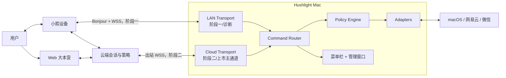
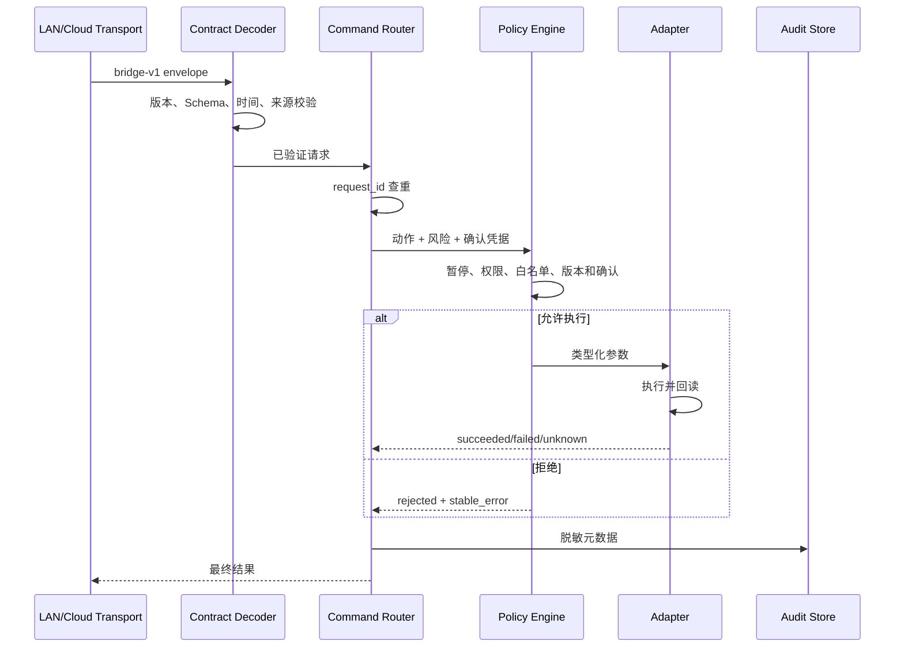

# Hushlight Mac 技术架构

## 2026-10-24 QQ可见会话预览

新增QQChatReading/NativeQQChatReadBackend：已运行com.tencent.qq的有界原生AX快照，纯解析器依当前QQ界面结构关联消息区域、输入区与标题；只返回可见文字和草稿是否存在，不返回草稿正文或稳定目标ID。BridgeService.qqChatSnapshot由LocalBridgeService持有同一后端，前后检查共享暂停与暂停版本，过时读回丢弃。AppModel提供单操作防重及清除generation，切页、暂停和显式清除拒绝迟到响应；页面不触发自动读取。该预览未开放Host/MCP，后续写入不得拿display name充作已认证目标身份。

## 2026-10-24 自动目标与持续群聊授权

自动视觉链为唯一目标窗口→本机OCR→按用户目标选择候选→新鲜窗口复核→执行→状态回读。选择与执行分离；识别结果不等于点击授权，聊天消息内容不具备创建会话、改群或解除暂停的权限。纠错次数有界，窗口/PID/目标或授权代际变化使旧候选失效；未知写入先核对，不重放。

新增独立目标选择服务和群聊会话控制核心，底层复用既有单窗口提供者与暂停。会话绑定连接/账号/群的可核实标识及授权代际；stop先失效租约再取消分析/待发任务，最终发送前复核身份/代际。启停及动作日志仅元数据，正文与窗口图片不进入普通日志。原邮件确认策略独立。真实群识别、上下文提取与发送适配分步接入，未实现时明确不可执行。

## 2026-10-24 手动天气复用联动执行链

AutomationEngine.runWeatherNow仅供App，对既有enabled天气规则准入；与tick共享串行闸门，沿用输入授权、加密接纳、process/queue/apply与最终租约。来源weather.manual.city.day独立于常规排程，不修改cursor/lastPolledAt；请求时间写受控metadata，时效15分钟且不跨Mac本地午夜。分析、效果和确认期限均核对时效；暂停代际与staleInput不混同来源撤权。无新增外部动作或系统授权入口。

## 2026-10-24 受限语音命令链

VoiceCommandPlanning复用AutomationCodexRunning独立会话，只输出严格JSON；VoiceCommandModel绑定源文本、提案UUID、五分钟期限和代际，确认前没有执行权。BridgeVoiceCommandExecutor通过同一BridgeService执行，写前原子持久化元数据、准入前重核授权与暂停。语音输入的系统权限与用户确认互相独立；手工文字可测试完整链。模型没有Mac工具，新增协议适配其他分析器，不向MCP新增发送或麦克风入口。

分析方式依据[官方Codex非交互执行](https://learn.chatgpt.com/docs/developer-commands#codex-exec)，沿用既有ephemeral、read-only、关闭工具及配置隔离；分析结果不落盘，写入账本不含原始输入/名称正文。

## 2026-10-24 窗口识别架构

WindowVisionProviding 分为显式权限、目标窗口发现、capturePreview 与 recognize(preview, region)。ScreenCaptureKit 按 Bundle ID + PID + windowID 绑定单窗口，关闭音频、光标、子窗口及阴影；仅 macOS14.2+，不回退全屏截图。预览 CGImage 在 App 内存显示，用户框选归一化范围后才裁剪送入本机 Vision；不用固定布局猜测内容边界。截取及识别前后核对身份/尺寸/权限，限制图像尺寸和像素预算。返回框映射到预览坐标，不提供执行点击；结果时间沿用预览时间。

WindowVisionModel 持有可取消任务，暂停、换目标/窗口或离页取消后续步骤，代际丢弃迟到结果并释放图像/文本。已经提交系统的单次截取可能仍返回，但不得再启动 OCR 或展示结果。截图/识别内容不进入日志、账本、磁盘、网络、模型或 MCP。后续动作须取得新鲜状态和独立授权。[Apple 单窗口过滤](https://developer.apple.com/documentation/screencapturekit/sccontentfilter/init(desktopindependentwindow:))。

## 2026-10-24 语音输入边界

App 持有共享 MacSpeechInputModel，各窗口复用同一录音会话与内存文本。原生后端封装 Speech 与 AVAudioEngine，先检查本机支持并强制 requiresOnDeviceRecognition；权限与启动必须由 App 显式交互触发。停止使代际失效并释放音频引擎，迟到识别回调不得恢复录音或覆盖文本。没有新增 MCP 麦克风接口、网络转写、持久化音频或自动执行入口。设备支持同时依据 supportsOnDeviceRecognition 与 request 标志，不能仅设置后者便声称离线。[Apple 设备端支持](https://developer.apple.com/documentation/speech/sfspeechrecognizer/supportsondevicerecognition)、[Apple 强制设备端请求](https://developer.apple.com/documentation/speech/sfspeechrecognitionrequest/requiresondevicerecognition)。

## 2026-10-23 当前架构增量

App 的唯一 Host 锁先于联动存储与调度初始化。AutomationEngine 负责冻结规则、持久运行、加密提案、效果去重和未知结果；BridgeAutomationInput/Effects 复用同一 BridgeService 和暂停；Codex/认证连接分析通过 AutomationAnalyzing 适配，最终系统动作仍由 App 执行。Notes/Mail 入口不弹窗检查权限，日历采用专用范围与写前账本。详见 [联动架构与接口](13_automation_workbench.md)。

## 2026-10-23 草稿与本地人工发送确认

增量 1.6 通过 `LocalMailDraftCoordinator → MailDraftWorkflow → AppleMailDraftBackend` 提供 draft.create/read/status 和 send.request。它们与既有 UI/MCP 共用运行时、参数校验和暂停；send.request 是 L2 的排队动作，实际外发只由 App UI 的完整预览与确认触发。Socket/MCP 不存在实际 send 或 confirm 操作。

`MailDraftWorkflow` 将 owner、scope 摘要、输入/版本摘要、native ID、请求时间和状态写入 0600 元数据账本，正文仍由原生 Mail 保存。临时文件同步、rename 及目录 fsync 全部成功后才允许 native send；creating/dispatching 在重启后为 unknown，防止重放。草稿读取限制 owner，UI 可核对所有工作台草稿。Host 在最后授权许可处核对来源连接、范围、暂停；工作流再同步检查状态、暂停与版本后占用发送状态，双重确认只有一次准入。

Native 脚本以固定 JSON stdin 传参，发件地址绑定唯一账户，发送前严格区分大小写/空白重核发件人、To/Cc/Bcc、主题、正文和零附件。Mail 各字段读取与 send 非原子，系统 Mail 中同时编辑仍有极短竞态；需实机核对，不宣称事务锁或送达回执。Agent 请求成功仅表示等待人工确认；通过 draft.status 读取 submitted/unknown 等最终记录。

## 2026-10-23 Apple Mail 只读增量

`AppleMailScopeBackend → LocalMailCoordinator → BridgeLocalRuntime` 复用通用校验、暂停、来源与执行记录。App UI 和 Host 的 `mail.search` / `mail.read` 调用同一服务；1.5 Schema 只扩展这两个 L0 动作，旧入口保持原行为。固定 AppleScript 通过 stdin JSON 接收参数，解析所选账户 ID 与完整邮箱路径；搜索仅元数据，读取返回纯文本，不加载附件或原始 MIME，不提供写入操作。

连接的可选 `mailScopeID` 保存授权时的范围摘要，旧连接默认无邮件授权。Host 发现过滤和执行前重核授权/摘要，通过可信 TaskLocal 传给后端；后端在系统调用前后核对选定范围。Host 交付正文前先等待最新服务状态，然后同步重验凭据与授权，防止 await 期间撤权泄露。正文和搜索结果不进入路由完成缓存；日志、磁盘账本仍只有元数据。Mail API 没有不可变邮箱 ID，授权对象是账户中的逻辑路径。

> 文档版本：V0.2
> 更新日期：2026-10-22
> 状态：开发基线

## 1. 架构结论

Hushlight Mac 采用“单一执行核心 + 双 Transport + 隔离适配器”。阶段一局域网 WSS 和阶段二云端 WSS 只负责传输，同一 `bridge-v1` 请求必须经过 `CommandRouter → PolicyEngine → Adapter → Result`。Debug 测试台也只能进入该链路。

### 1.1 无硬件与复用入口（D-MAC-014，2026-10-22）

`BridgeCore` 是独立 SwiftPM library，持有协议资源、校验器、策略、路由与适配器。`HushlightMac` 通过 `LocalBridgeService` 接入公开 `BridgeLocalRuntime`；`hushlight-bridge` 经兼容 `BridgeLocalCLIEngine` facade 委托同一运行时实现。两个产品复用执行代码，各进程实例仍独立。App 只注册音量读取，未暴露写入按钮。

运行时公开 `submit`、`setPaused`、`snapshot` 与只读便捷接口 `readSystemVolume`。便捷接口生成 UUIDv7 请求及 nonce 后同样进入 submit；不直调适配器。快照只保存最近 50 条动作元数据，结果带模拟标识。

App 内主窗口与菜单栏共享一个模型和服务。暂停设置与 UserDefaults 写入在同一串行操作链中，读取/快照等待最新切换；初始化恢复保存的暂停选择，不重放任何动作。界面的“本地可用”只表示核心初始化成功，适配器执行结果单独展示。GUI 手工验收仍待原生 UI 通道恢复。

CLI NDJSON → 本地来源限制 → BridgeCommandProcessor → 参数校验 / ReplayGuard → CommandRouter → PolicyEngine → 适配器 → JSON 结果。CLI 无网络监听，仅接受 `debug_console`，不把本地来源标签当作设备/云端身份鉴权。系统进程权限是本机调用边界；未来远程入口必须另外鉴权。

默认只注册 Core Audio 读取；`--allow-volume-control` 才注册真实写入；`--simulate` 仅 Debug 可用，输出 `mode=simulation`。模拟适配器不操作系统。`--paused` 在初始化时暂停路由。结果缓存、防重放与模拟状态均只在同进程存续；不得假设重复启动仍能防止重复执行。

Core Audio 适配器固定操作读取到的默认输出设备，仅使用主输出音量属性，不写静音、不切设备。设置后回读失败、设备变化或误差超过 1 个百分点返回 `unknown/result_unverifiable`；不支持主音量的设备明确失败，不降级为脚本或声道盲写。

模拟代码从 Release 排除；独立 CLI 不打包进用户 App。无硬件软件验收不关闭配对、云端或设备 Gate。手机语音、ASR 和 Codex 网关都是未来调用方，不直接调用适配器。

## 2. 输入基线

- 根产品基线：`../../docs/01_prd.md`。
- 根决策：`../../docs/07_decisions.md` 中 D-003、D-004、D-005、D-006、D-007、D-010、D-011、D-012、D-020。
- Mac 需求：`01_prd.md`。
- 协议：`08_bridge_protocol.md`。
- 适配器规格：`09_local_adapter_spec.md`。

## 3. 系统上下文与阶段差异

阶段一 LAN 是研发主通道和后续诊断能力，不是上市默认路由。阶段二以后设备动作由云端策略下发；Bridge 不开放公网入站端口。

## 4. 进程与模块

首版保持单一用户态 App 进程，不增加特权 Helper。适配器在代码边界和能力注册表中隔离；只有经过支持版本和故障证据证明单进程不足时，才另行评审 XPC 拆分。

| 模块 | 职责 | 禁止 |
| --- | --- | --- |
| App Shell | 生命周期、菜单栏、管理窗口、Dock 策略 | 直接执行工具 |
| State Store | 聚合连接、权限、能力和最近动作 | 保存消息正文或令牌 |
| LAN Transport | Bonjour、WSS、配对和设备会话 | 绕过协议校验 |
| Cloud Transport | 登录令牌、出站 WSS、心跳和重连 | 自主重放 L3 |
| Contract Decoder | 版本、消息类型和 Schema 校验 | 宽松接受未知字段语义变化 |
| Command Router | 请求查重、路由、生命周期 | 直接调用系统私有行为 |
| Policy Engine | 暂停、权限、风险、确认、白名单和版本判断 | 将“已发起”变成成功 |
| Capability Registry | 工具、适配器、版本和启停状态 | 注册任意 Shell 或文件访问 |
| Adapters | 参数校验、执行、回读和错误归一 | 跨适配器扩大权限 |
| Audit Store | 脱敏动作元数据和滚动诊断 | 保存联系人、正文、令牌和敏感路径 |

## 5. 执行链

`ack` 只表示已接收。只有 Adapter 回读或有明确定义的系统成功证据时才能返回 `succeeded`。

## 6. 局域网连接与配对

- Network.framework 发布 `_hushlight-bridge._tcp` Bonjour 服务，端口由系统分配。
- Info.plist 声明 `NSLocalNetworkUsageDescription` 和使用的 Bonjour 服务类型；macOS 15+ 单独验证允许、拒绝和恢复。
- 使用 WSS；Bridge 生成本机自签名 TLS 身份，设备在配对时固定公钥指纹。
- 配对码为一次性、5 分钟有效，连续失败限流；配对成功后生成 256 位随机密钥。
- Bridge 私钥、配对密钥和云端刷新凭据进入 Keychain；设备侧密钥进入其安全存储。
- 请求校验 `request_id`、`issued_at`、`expires_at` 和 `nonce`；重放缓存至少覆盖请求有效期和已完成结果保留期。
- 阶段一真实设备使用安全配对握手；本机 stdin 测试入口不冒充设备，也不需要网络握手，但使用相同命令校验与策略链。Release 不编译模拟实现。

## 7. 云端连接

- Bridge 通过 Web 登录回跳获得一次性授权码，换取短期访问令牌和刷新凭据。
- 仅建立出站 WSS；心跳、指数退避和抖动重连不得重放已过期或 L3 请求。
- 连接建立后上报版本、平台、能力、适配器支持版本、权限和暂停状态，不上报本地消息正文。
- 云端可停用单个能力；本地权限、暂停和版本判断始终拥有最终拒绝权。
- LAN 与 Cloud 只实现 `BridgeTransport` 接口，不拥有动作语义。

## 8. 风险、确认与幂等

| 风险 | 示例 | 执行规则 |
| --- | --- | --- |
| L0 | 状态和能力查询 | 已鉴权即可读取脱敏结果 |
| L1 | 音量、媒体控制、打开白名单内容 | 已授权可执行，必须回读 |
| L2 | 创建/修改计时器、提醒事项、搜索播放 | 已授权执行，参数完整且可追踪 |
| L3 | 微信发送 | 草稿、复述、短时确认、单次发送、禁止自动重试 |
| L4 | Shell、支付、任意文件、批量删除 | 不注册、不执行 |

确认凭据绑定用户、设备、Bridge、工具、联系人稳定标识、草稿摘要和有效期。草稿或收件人变化、断线、超时、应用状态未知或使用过一次后立即失效。

## 9. 适配器策略

接入优先级为系统正式接口、应用正式接口/URL Scheme、稳定合规的云端 API、AXUIElement。使用 AXUIElement 时必须：

- 绑定已测试应用版本。
- 只按角色、标题、标识等稳定语义查找元素。
- 不通过屏幕坐标盲点点击。
- 校验目标应用、窗口和关键状态。
- 超时、元素缺失、版本未知或结果不可验证时停止并返回失败或未知。
- 单个适配器可被本地或云端停用，不影响其他能力。

## 10. 数据与隐私

| 数据 | 位置 | 保留 | 约束 |
| --- | --- | --- | --- |
| TLS 私钥、配对密钥、刷新凭据 | Keychain | 绑定/登录存续期 | 不导出到诊断包 |
| 非敏感偏好、Dock 和自启选择 | UserDefaults | 安装存续期 | 不保存凭据 |
| 计时器状态 | Application Support | 完成/取消后删除 | 原子写入，重启恢复 |
| 动作元数据 | Application Support | 最多 500 条或 7 天 | 工具、时间、结果、错误码；无正文/联系人 |
| 滚动诊断 | Application Support | 最多 20 MB 或 7 天 | 无令牌、正文和敏感路径 |
| 关系与偏好记忆 | 云端 | 根产品规则决定 | Bridge 不拥有权威副本 |

卸载说明区分应用删除、登录项注销和可选本地数据清理；注销必须删除云端刷新凭据和绑定密钥。

## 11. 应用、权限与交付

- 阶段一建立 Xcode `.app` target，Bundle ID 固定为 `com.hushlight.bridge.mac`，使用 Development signing；这不代表正式产品交付。
- 最低 macOS 13。Dock 默认隐藏；用户切换后调整激活策略并重启应用。
- 开机启动只由用户选择，阶段三使用 `SMAppService`；不写入 LaunchAgent plist，不请求管理员权限。
- 官网分发不启用 App Sandbox，阶段三启用 Hardened Runtime、Developer ID、secure timestamp、`notarytool` 和 stapling。
- 自动更新固定 Sparkle `2.9.4`，使用精确版本、EdDSA appcast、灰度渠道和上一版本回滚；引入前必须完成依赖登记和安全评审。

## 12. 故障和降级

| 故障 | 行为 |
| --- | --- |
| 本地网络被拒绝 | LAN 进入不可用，展示系统设置恢复路径；不影响 Cloud |
| 云端离线 | 不接受新远程动作；设备保留基础聊天 |
| Bridge 暂停 | 保持诊断和恢复入口，全部工具请求返回 `rejected` |
| 权限缺失 | 只停用对应能力，返回权限错误和恢复路径 |
| 应用未安装或版本不兼容 | 停用对应适配器，不自动安装、不盲操作 |
| 适配器超时 | 返回 `failed` 或 `unknown`；L3 不自动重试 |
| 更新失败 | 恢复上一可用版本，不恢复待执行 L3 请求 |
| 日志或存储写入失败 | 动作结果不因日志失败改变；诊断状态明确降级 |

## 13. 架构待输入

| 输入 | Owner | 截止 Gate |
| --- | --- | --- |
| 云端登录、WSS 和确认凭据接口 | 云端/Web Owner | S2 开始前 |
| 设备侧 `bridge-v1`、TLS 和安全存储实现 | 设备固件 Owner | S1 Gate 前 |
| 网易云安装包和支持版本 | macOS/Test Owner | S1-W4 开始前 |
| 微信测试账号和测试联系人 | 产品/Test Owner | S1-W5 开始前 |
| Apple 证书、域名和更新源 | 项目负责人 | S3 开始前 |

## 14. 计时器运行链（2026-10-22）

App 服务注入通知后端和本地 JSON 存储；运行时仅在显式提供协调器时注册既有 timer 动作，CLI 默认不注册。服务先完成运行时模式/能力校验，再恢复通知，避免模拟模式下先发生真实恢复副作用。

命令经过同一策略/路由，计时器协调器在独立串行域内先保存期望状态与 pending，再调用 UserNotifications 并核对当前 ID；成功后清除 pending，不能核实时 unknown。恢复与授权变化只处理受本 App 管理的稳定 ID；不访问系统 Reminders。允许撤权后取消，不允许撤权后新建或修改。

系统通知中心仅由正确 App bundle 获取，启动不提示授权，权限按钮按需请求。通知使用明确 UTC 绝对日期；同一 ID 替换未来通知，过期不补发。最多 128 个未来计时器，标签只在本地存储和用户通知中，不进入动作日志。JSON 损坏保留原文件，降级只影响计时器。

当前仅完成源码、注入式自动测试与开发包构建；真实 OS 授权、到时显示和 GUI 仍待验收，不能把排程回读当作用户已收到提醒。

## 提醒事项增量（2026-10-22）

App → LocalBridgeService → BridgeLocalRuntime → 校验/策略/暂停/路由 → LocalReminderCoordinator → EventKitReminderBackend。协调器串行执行并回读；后端仅对保存的专用列表 ID 构造谓词，过滤 Bridge URL 标记。不枚举其他列表内容，不按标题收编同名列表。系统完整授权与专用列表初始化仅由明确的启用按钮触发，未启用时启动/刷新不弹窗。

新增协议资源 `bridge-v1.1.schema.json`，新增 reminder.complete；1.0 资源和标准能力注册表保持原有 17 actions。启用提醒事项协调器才使用扩展注册表。提醒事项适配器与通知计时器相互独立，任何一项失败不使整个本地核心不可用。

## 备忘录增量（2026-10-23）

App → LocalBridgeService → BridgeLocalRuntime → note.list/read/create/append（协议 1.2）→ LocalNotesCoordinator → AppleNotesBackend → 系统 osascript → Apple Notes 自带脚本接口。脚本源码固定，用户内容仅经 stdin JSON 传输；不是 GUI 脚本，也不申请辅助功能。每次启动需明确连接，不在 snapshot/初始化阶段发送 Notes AppleEvent。

默认账户内显式创建专用“小熙 Bridge”文件夹后保存账户与文件夹 ID；已有同名未登记文件夹会拒绝接管。所有笔记查询都在该文件夹下，查询仅匹配标题。共享/加锁笔记拒绝读取，附件不读取，含附件笔记不能追加。新增笔记以本地 ID 映射记录所有权，不接管其他笔记。

`notes.json` 原子保存范围、ID、HTML revision 和待核对操作的文本/HTML 哈希，不保存笔记正文。写前持久化 pending，写后核对纯文本及 HTML；仅忽略标签间排版换行，不忽略格式/属性变更。未知结果保留 pending 并禁止重复写，显式重新连接只做回读恢复，不重放写命令。脚本标注写操作是否可能已经提交，只有明确前置拒绝才清 pending。Notes 无原子 CAS，本方案是受控乐观核对，不宣称可完全排除同时外部编辑的竞态。

1.0 的 17 actions、1.1 的 18 actions 保持兼容；1.2 增加 4 个 Notes actions。CLI 不注入 Notes 后端，App/CLI 仍无跨进程统一暂停。

## 天气增量 1.3（2026-10-23）

weather.get（L0，city_id 固定枚举）经共享运行时、路由、暂停进入 LocalWeatherCoordinator，再调用可替换 WeatherBackend。App 默认 METWeatherBackend，URLSession 只允许 HTTPS api.met.no 的 Locationforecast 2.0 compact 路径，不跟随重定向、不带 Cookie/凭据，流式响应有大小限制。没有初始化/状态刷新自动请求，也没有定位。

12 城市坐标为预设近似城市中心。MET 文档内单位、坐标、数值、时刻与连续小时序列必须通过核对；当前时段取不晚于现在的最新整点，提供下一段连续 12 小时。数据是数值模式预报，不标为实测。缓存有界且仅在内存，尊重有效 Expires，显式过期/无效 Expires 不复用；过期条件请求可接受 304，保留原获取时间，失败不返回过期数据冒充成功。

App 显示模式更新时间、预报时刻、获取时间、缓存与模拟标记，按城市时区格式化。来源署名 MET Norway，许可证 CC BY 4.0。官方参考：https://docs.api.met.no/doc/ForecastJSON 、https://docs.api.met.no/doc/TermsOfService 、https://docs.api.met.no/doc/License 。1.0/1.1/1.2 资源不变，1.3 增加天气；CLI 未注入真实天气后端。

## 定位增量 1.4（2026-10-23）

App 明确请求使用中权限，授权后 location.get 经统一运行时 → LocalLocationCoordinator → CoreLocationBackend → MainActor OneShotLocationController → CLLocationManager.requestLocation。构造 manager 与请求授权/定位均推迟到明确动作；snapshot 未检查时返回 notChecked，已检查后只读取授权/系统开关，不新建 manager。状态查询和采样均不触发天气请求。

原生 driver 对每次采样使用新 manager generation，任何完成、错误、超时或取消都 stopUpdatingLocation；token 屏蔽旧 manager 回调。采样返回后再次检查应用授权与系统定位开关，在最终检查之后不再挂起才交付临时样本。前台通知会触发无采样状态复查，权限失效清掉位置显示，即使其他操作 busy 也可复查。

核心只接受有效有限坐标、正水平精度和 60 秒内/未来不超过 5 秒的时间戳。临时原样本量化到两位小数才进入命令结果，报告精度至少 1500m。没有精确坐标日志、磁盘记录、地址解析或后台轨迹；不自动向天气 provider 提交位置。位置显示可清除。

**结果缓存例外**：location.get 不写入 completedResults，执行记录只留 request_id 和原有效期。并发同 ID 合并正在执行的请求；完成后同 ID 新 nonce 为 replay_detected，不会重新定位，也不能恢复旧位置。其他动作的既有结果缓存行为不变。App/CLI 仍各自独立进程；CLI 不注入真实定位。

## Agent 工作台统一服务（D-MAC-022）

SwiftUI 页面与菜单栏共享一个 LocalBridgeService；WorkbenchHost 持有该实例，对外通过 WorkbenchKit 版本化 NDJSON Unix Domain Socket 接口服务。agent-workbench-mcp 是 STDIO MCP 转发器，不创建独立运行时。旧 hushlight-bridge 仍为独立调试入口，其暂停不代表工作台暂停。

Agent 连接凭据绑定调用方 ID，能力按读取/写入分开，定位独立；创建连接默认无授权。目录 0700、Socket/凭据文件 0600，并核对 peer UID。同一系统用户属于信任边界，不宣称凭据能隔离该用户下的恶意进程。App 退出即服务不可用，关闭窗口保留菜单栏运行。

执行前检查授权及全局暂停，后端保持现有范围和版本校验。写入去重账本仅保存请求与参数摘要、来源和结果状态，禁止写入正文或坐标。重启未决写入保留 unknown，不自动重放。新接口独立版本化，不修改 bridge-v1 的远端来源信任规则。

## QQ 音乐状态入口（2026-10-23）

QQMusicStatusBackend 仅读 NSWorkspace 注册信息、Bundle ID/版本及 NSRunningApplication 进程。通过 BridgeService.qqMusicStatus 统一接入 LocalBridgeService，App与认证Host共享服务和暂停；Host版本1新增只读music.qq.status，由music.read独立授权，MCP按授权过滤。结果播放状态恒unknown、controlsAvailable=false，不能作为媒体播放成功证据。不使用私有播放协议、全局媒体键或任意脚本。

## QQ 播放栏与静默定位授权恢复（2026-10-24）

QQ控制经独立Host动作music.qq.playback/play/pause/next/previous接统一BridgeService；读播放信息与控制分别授权，旧music.read不扩权。写请求先记元数据账本，终态unknown不可重放；原bridge CLI不扩协议。native AX限定bundle/window/结构播放栏，单写槽覆盖所有入口。用户改控件或撤权时重新核对；工具不请求系统权限。MCP/skill均区分安装信息、播放状态和实际操作结果。

定位权限读取现可被动创建MainActor CLLocationManager，不调用权限申请或取点，等待初始授权状态；取点新manager、一次重试以及并发读取均保留初始等待与代际检查。此变更替代早期“只有显式动作才创建manager”的实现限制，仍保持切换页面不申请权限、不取位置。真实同签名更新已观察授权恢复；不将静态测试推为真实坐标取点通过。

## 2026-10-24 QQ歌曲搜索执行链

App / MCP → WorkbenchHost授权与写入去重 → LocalBridgeService共享音乐写槽与最终暂停检查 → QQSongPlaybackCoordinator持久准入 → NativeQQSongSearchBackend。后端只激活已运行QQ，AX核实搜索框/窗口，CGEvent提交查询，单窗口Vision候选核对，双击后AX回读。加载期有界重采样；只对确证新错误曲目重搜一次；unknown禁止重放。参数title/artist/version严格校验，caller来自认证TaskLocal而非正文。coordinator目录0700、账本0600，独占锁及fsync/rename保护准入记录；账本保留摘要与结果状态，不保留OCR和搜索正文。微信会话协调器尚未接原生sender。

## 2026-10-24 Codex窗口候选选择

WindowVisionModel默认注入CodexWindowTextSelector → 本机Vision观测 → 有界候选JSON → 既有无工具临时Codex runner → 严格解析原始index → AutomaticWindowSelectionService最终置信度/坐标校验 → generation与最终授权检查 → 预览。没有图片上传或新增Agent Mac工具，既有单窗口来源限制保持。ExactWindowTextSelector保留供本机确定性测试/QQ管线，不把两者验收混淆。
